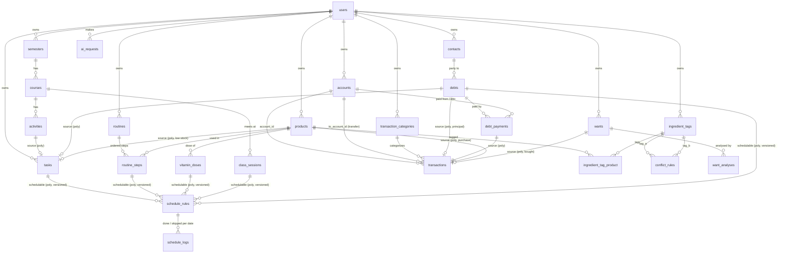

# Synop — Database Design

**Status:** Approved · **Last updated:** 2026-11-16
**Source:** [PRD.md](PRD.md)

---

## 1. Conventions

### 1.1 Ownership and isolation
- Every user-owned table has `user_id`: `foreignId('user_id')->constrained()->cascadeOnDelete()`. The foreign key gives it an index automatically.
- This includes child tables (e.g. `routine_steps`, `schedule_logs`) even though the parent already has a `user_id`. It's a small amount of duplication, but it lets the `BelongsToUser` global scope filter *every* query the same way. The Action that creates a child row copies `user_id` from the parent, and tests check it.
- Every user-owned model uses the `BelongsToUser` trait and has a Policy (CLAUDE.md, hard rule 1).
- **Cross-user links must be impossible.** When a row points to another row (e.g. a routine step's `product_id`, a payment's `account_id`), the Action checks that the target belongs to the same user. Validation uses `Rule::exists(...)->where('user_id', auth()->id())`.

> **Global scope** (learning note): a filter Laravel adds automatically to every query on a model. `BelongsToUser` adds `where user_id = <current user>`, so you can't forget it.

### 1.2 Money
- Stored as **centavos** in `BIGINT` columns named `*_cents` (₱1,234.50 → `123450`). Never `FLOAT`/`DECIMAL`.
- Signed `BIGINT` everywhere. Amounts that must be positive (transaction amounts, prices) are validated `>= 0` / `> 0` in the app. The sign of a transaction comes from its `type`, never from a negative amount.
- One currency per user (`users.currency`, default `PHP`). No multi-currency (PRD §6).

### 1.3 Time
There are two kinds of time, stored differently:

| Kind | Example | Column type | Stored as |
|---|---|---|---|
| **An instant** (something happened) | `completed_at`, `created_at`, `settled_at` | `TIMESTAMP` | **UTC**, converted to the user's timezone for display |
| **A calendar date or wall-clock time** (a plan) | due date, class at 08:00, purchase date | `DATE` / `TIME` | **As the user means it**, in their own timezone. No conversion. |

Why: a class at 08:00 MWF must stay at 08:00 regardless of UTC offsets, and a due date of "Nov 20" must not shift to Nov 19 when converted. Columns ending in `_at` are UTC instants; columns ending in `_on` are dates; `*_time` columns are local wall-clock times.

"Today" is always computed as `now($user->timezone)->toDateString()`.

### 1.4 Soft deletes
Used only where the user may want to restore data, or where deleting would break money history:

| Soft deletes | Why |
|---|---|
| `products` | Accidental delete of an item with history (logs, spending) |
| `accounts` | Transactions reference it; balances must stay correct |
| `transactions` | Money history; restore after a mistake |
| `contacts` | Debts reference them |
| `debts`, `debt_payments` | Money history |
| `routine_steps`, `vitamin_doses` | Keep done/skipped history for future "routine consistency" charts. Their schedule rules and logs stay. |

Everything else is hard-deleted. Finished/discarded products use `status`, dropped wants use `status`, old semesters use `archived_at` — these are states, not deletions.

> **Soft delete** (learning note): instead of removing the row, Laravel fills a `deleted_at` column and hides the row from normal queries. `restore()` brings it back.

### 1.5 Other conventions
- Primary keys: `id` BIGINT unsigned auto-increment (Laravel `$table->id()`).
- All tables have `created_at` / `updated_at` unless noted.
- **Enums** are `VARCHAR(20)` columns cast to PHP backed enums (`app/Enums`), not MySQL `ENUM`. Adding a value then needs no migration.
- **Polymorphic relations** use a morph map with short aliases (`task`, `routine_step`, `debt_payment`…), registered with `Relation::enforceMorphMap()`. So the DB stores `'task'`, not `'App\Models\Task'`, and renaming a class won't break data.
- Polymorphic columns can't have real foreign keys. Cleanup when the parent is deleted is done in the parent model's `deleting` event (or the Action that deletes it), and is covered by tests.
- Table names are plural snake_case; pivot tables are singular names in alphabetical order (Laravel default).

> **Polymorphic relation** (learning note): one table can point to rows in *different* tables using two columns: `*_type` (which table) and `*_id` (which row). E.g. a schedule rule can belong to a task *or* a routine step.

---

## 2. ERD

Every table except `users` has a `user_id` → `users`. To keep the diagram readable, only the top-level ownership lines from `users` are drawn. "poly" = polymorphic link.

---

## 3. Tables

Column notes: **FK** = foreign key, **N** = nullable. `user_id` (FK → users, cascade) and `created_at`/`updated_at` are present on every user-owned table and not repeated below.

### 3.1 Core

#### `users` (extends Laravel's default)
| Column | Type | Notes |
|---|---|---|
| id, name, email, password, remember_token, email_verified_at | Laravel default | |
| timezone | VARCHAR(64) | Default `Asia/Manila`. IANA name. |
| currency | CHAR(3) | Default `PHP`. Display only in MVP. One of `PHP`, `USD`, `EUR`, `GBP`, `SGD`, `AUD`, `CAD`, `HKD` (`App\Enums\Currency`, D-035). |
| safety_buffer_cents | BIGINT | Default 0. Used by safe-to-spend. |
| morning_summary_time | TIME, N | Local time for the web-push summary (Phase 8). |
| payments_due_days | TINYINT unsigned | Default 7. Today's "Payments due" shows debts due within this many days, plus overdue. |

**On registration** the Action that creates a user also creates: default `transaction_categories`, one AM and one PM `routine`, and the starter `ingredient_tags` (AHA, BHA, Retinoid, Vitamin C, Niacinamide, Benzoyl peroxide — editable). No conflict rules are pre-made; users write their own (PRD §6).

Framework tables (`sessions`, `cache`, `jobs`, `password_reset_tokens`, and Phase 8's `push_subscriptions` from the web-push package) are used as shipped and not documented here.

### 3.2 Shared building blocks

#### `schedule_rules` — the schedule engine's input
Describes *which dates* something happens on; times of day live on the owning row (class session, vitamin dose, task).

**Versioned rules.** An item can have several rules over time (`morphMany`), but their date ranges never overlap, so exactly one applies on any date. Editing a schedule:
- If the current rule started **before today**: set its `ends_on` = yesterday and create a new rule with `starts_on` = today. Old logs stay on the old rule, so history stays accurate.
- If it starts **today or later** (no history yet): edit it in place.

The item's *current* rule is the one whose range covers today (or the next upcoming one). Done in `app/Actions/UpdateSchedule`, never by editing rows directly.

| Column | Type | Notes |
|---|---|---|
| id | BIGINT | |
| user_id | FK | |
| schedulable_type | VARCHAR(40) | Morph alias: `task`, `routine_step`, `vitamin_dose`, `class_session`, `debt` |
| schedulable_id | BIGINT | |
| frequency | VARCHAR(20) | `daily` · `every_n_days` · `weekly` · `monthly` |
| interval | SMALLINT unsigned, N | For `every_n_days` (≥ 2). Counted from `starts_on`. |
| weekdays | JSON, N | For `weekly`: ISO weekday numbers, e.g. `[2,6]` = Tue, Sat. Cast to array. |
| day_of_month | TINYINT unsigned, N | For `monthly`: 1–31. In shorter months it falls on the last day (31 → Nov 30, Feb 28/29). |
| starts_on | DATE | Required. First possible date. |
| ends_on | DATE, N | Last possible date (inclusive). Null = no end. |
| paused_at | TIMESTAMP, N | Paused rules produce no occurrences. |

Indexes: (`schedulable_type`, `schedulable_id`, `starts_on`); (`user_id`, `paused_at`).

Validation: exactly the field for the chosen frequency is filled (`interval` / `weekdays` / `day_of_month`); `ends_on >= starts_on`; no overlap with the item's other rules.

The engine (`app/Services/ScheduleEngine`) answers *"does this rule occur on date D?"* and *"list occurrences between D1 and D2"*. It's pure PHP; the DB just stores the rule.

| Frequency | Example | Stored |
|---|---|---|
| daily | Cleanser every morning | `frequency=daily` |
| every N days | Mask every 3 days | `frequency=every_n_days, interval=3` |
| weekdays | Exfoliant Tue/Sat; class MWF | `frequency=weekly, weekdays=[2,6]` / `[1,3,5]` |
| monthly | Debt installment on the 15th | `frequency=monthly, day_of_month=15` |

#### `schedule_logs` — done / skipped per date
| Column | Type | Notes |
|---|---|---|
| id | BIGINT | |
| user_id | FK | |
| schedule_rule_id | FK → schedule_rules, cascade | |
| occurs_on | DATE | The occurrence date being logged (user's local date) |
| status | VARCHAR(20) | `done` · `skipped` |
| logged_at | TIMESTAMP | UTC instant the user tapped it |

Indexes: unique (`schedule_rule_id`, `occurs_on`) — one log per occurrence; (`user_id`, `occurs_on`) for the Today view.

Un-ticking an item deletes its log row. These rows are the PRD's "usage logs". Marking a vitamin dose `done` also decrements stock (done in the Action, not the DB).

#### `transactions` — every money movement
| Column | Type | Notes |
|---|---|---|
| id | BIGINT | |
| user_id | FK | |
| account_id | FK → accounts, restrict | The account money leaves (expense, transfer) or enters (income) |
| to_account_id | FK → accounts, N, restrict | Transfers only: destination account |
| type | VARCHAR(20) | `income` · `expense` · `transfer` · `debt_out` · `debt_in` |
| amount_cents | BIGINT | Always > 0 |
| category_id | FK → transaction_categories, N, null on delete | Null for transfers |
| occurred_on | DATE | Local date |
| note | VARCHAR(255), N | |
| source_type | VARCHAR(40), N | Morph alias: `product`, `debt`, `debt_payment`, `want` |
| source_id | BIGINT, N | |
| deleted_at | TIMESTAMP, N | Soft delete |

Indexes: (`user_id`, `occurred_on`); (`account_id`); (`to_account_id`); (`source_type`, `source_id`); (`user_id`, `category_id`, `occurred_on`) for monthly spending.

**Debt types.** Money lent or borrowed is expected to come back, so it is **not** income or spending — but it does change how much money you have right now. So debts get their own two types:

| Type | When | Balance | Spending / income reports |
|---|---|---|---|
| `debt_out` | I lend money (principal of `owed_to_me`), or I repay someone (payment on `i_owe`) | − | Excluded |
| `debt_in` | I borrow money (principal of `i_owe`), or someone repays me (payment on `owed_to_me`) | + | Excluded |

Reports only ever look at `income` and `expense`, so there's no "remember to exclude debts" rule to forget.

**Account balance** = `opening_balance_cents` + (`income` + `debt_in` into it) − (`expense` + `debt_out` from it) − transfers out (`account_id`) + transfers in (`to_account_id`). Transfers cancel out in the total balance.

Rules: `transfer` requires `to_account_id` ≠ `account_id` and no category; all other types require no `to_account_id`; `debt_in`/`debt_out` have no category and must have a `debt` or `debt_payment` source. Rows with a `source` are created by that source's Action inside a DB transaction, so they can't drift apart.

### 3.3 Tasks

#### `tasks`
| Column | Type | Notes |
|---|---|---|
| id | BIGINT | |
| user_id | FK | |
| title | VARCHAR(255) | |
| notes | TEXT, N | |
| due_on | DATE, N | One-off tasks. Ignored for recurring tasks. |
| due_time | TIME, N | Optional local time |
| priority | VARCHAR(20) | `low` · `normal` (default) · `high` |
| completed_at | TIMESTAMP, N | One-off tasks only. Recurring tasks log per date in `schedule_logs`. |
| source_type | VARCHAR(40), N | Morph alias: `activity`, `debt`, `product` |
| source_id | BIGINT, N | |

Indexes: (`user_id`, `completed_at`, `due_on`) for today / overdue / upcoming / done filters; unique (`source_type`, `source_id`) — one auto-task per source (MySQL allows many NULLs, so manual tasks are fine).

A task is **recurring** when it has a `schedule_rule`. Auto-created tasks are kept in sync by the source's Action (e.g. settling a debt sets the task's `completed_at`).

**Deleting auto-created tasks:**
- `source = activity` or `debt`: blocked by the Policy. The user is told to delete the activity/debt instead (which deletes its task).
- `source = product` (low stock): allowed. A new one is created only after stock is restocked above the threshold and later drops again.

### 3.4 Finance

#### `accounts`
| Column | Type | Notes |
|---|---|---|
| id | BIGINT | |
| user_id | FK | |
| name | VARCHAR(100) | "GCash", "BPI Savings" |
| type | VARCHAR(20) | `cash` · `ewallet` · `bank` |
| opening_balance_cents | BIGINT | Default 0 |
| deleted_at | TIMESTAMP, N | Soft delete |

Index: (`user_id`, `name`).

#### `transaction_categories`
| Column | Type | Notes |
|---|---|---|
| id | BIGINT | |
| user_id | FK | |
| name | VARCHAR(50) | "Food", "Skincare", "Allowance" |
| kind | VARCHAR(20) | `income` · `expense` |

Index: unique (`user_id`, `kind`, `name`). A default set is created when the user registers.

#### `contacts`
| Column | Type | Notes |
|---|---|---|
| id | BIGINT | |
| user_id | FK | |
| name | VARCHAR(100) | |
| note | VARCHAR(255), N | |
| deleted_at | TIMESTAMP, N | Soft delete |

#### `debts`
| Column | Type | Notes |
|---|---|---|
| id | BIGINT | |
| user_id | FK | |
| contact_id | FK → contacts, restrict | |
| direction | VARCHAR(20) | `owed_to_me` · `i_owe` |
| principal_cents | BIGINT | > 0 |
| description | VARCHAR(255), N | "Concert ticket" |
| account_id | FK → accounts, N, restrict | Account the principal left/entered. Null = debt from before using the app (no money movement). |
| started_on | DATE | When the money was lent/borrowed |
| due_on | DATE, N | One-off due date. Creates a linked task. Null for installment debts. |
| installment_cents | BIGINT, N | Installment debts only: amount due per occurrence of its `schedule_rule` |
| status | VARCHAR(20) | `open` · `settled` |
| settled_at | TIMESTAMP, N | |
| deleted_at | TIMESTAMP, N | Soft delete |

Indexes: (`user_id`, `status`, `due_on`) for "Payments due"; (`contact_id`).

**Remaining** = `principal_cents` − sum of its `debt_payments.amount_cents`. Computed, not stored. When it reaches 0 the Action sets `status=settled`, `settled_at`, and completes the linked task.

**Installments.** A debt is either *one-off* (`due_on` set) or *installment* (`installment_cents` set + a `schedule_rule`, e.g. ₱500 monthly on the 15th, with the rule's `ends_on` as the final date). Never both. Validation: `installment_cents` ≤ `principal_cents`.

- **Next due date** = the first rule occurrence where *(occurrences so far × `installment_cents`)* is more than the total paid. This handles partial, late and extra payments without storing a row per installment.
- **Amount due on it** = the smaller of `installment_cents` (plus anything behind) and the remaining balance.
- **Linked task:** one task per debt. For installment debts its `due_on` moves forward to the next due date after each payment, and it's completed when the debt is settled.
- **Safe-to-spend** counts the `i_owe` installments (and one-off `i_owe` debts) falling due before the chosen date, capped at what's remaining.

#### `debt_payments`
| Column | Type | Notes |
|---|---|---|
| id | BIGINT | |
| user_id | FK | |
| debt_id | FK → debts, cascade | |
| account_id | FK → accounts, restrict | Account paid from (`i_owe`) or into (`owed_to_me`) |
| amount_cents | BIGINT | > 0, ≤ remaining |
| paid_on | DATE | |
| note | VARCHAR(255), N | |
| deleted_at | TIMESTAMP, N | Soft delete |

Index: (`debt_id`). Each payment creates exactly one `transaction` with `source = debt_payment` (`debt_in` for `owed_to_me`, `debt_out` for `i_owe`). Deleting/restoring a payment does the same to its transaction.

### 3.5 Personal Care

#### `products` — skincare, makeup and vitamins
| Column | Type | Notes |
|---|---|---|
| id | BIGINT | |
| user_id | FK | |
| type | VARCHAR(20) | `skincare` · `makeup` · `vitamin` |
| brand | VARCHAR(100), N | |
| name | VARCHAR(150) | |
| category | VARCHAR(50), N | Free text: "serum", "sunscreen", "lip tint" |
| price_cents | BIGINT, N | |
| purchased_on | DATE, N | |
| opened_on | DATE, N | |
| pao_months | TINYINT unsigned, N | Period after opening |
| printed_expiry_on | DATE, N | Expiry printed on the package, entered by the user |
| expires_on | DATE, N | Stored, recomputed on save: the **earlier** of `printed_expiry_on` and `opened_on + pao_months` (whichever exist) |
| quantity | SMALLINT unsigned | Default 1. How many of this item you have. |
| status | VARCHAR(20) | `unopened` · `in_use` · `finished` · `discarded` |
| ingredients_text | TEXT, N | Raw list as pasted / scanned and reviewed. Scanned label images are sent to the AI once and discarded, never stored. |
| units_left | INT unsigned, N | Vitamins: tablets/capsules remaining |
| low_stock_threshold | INT unsigned, N | Vitamins: create a task at or below this |
| notes | TEXT, N | |
| deleted_at | TIMESTAMP, N | Soft delete |

Indexes: (`user_id`, `type`, `status`); (`user_id`, `expires_on`) for "expiring soon" (≤ 14 days); (`user_id`, `type`, `purchased_on`) for monthly spending.

Monthly personal-care spending = sum of `price_cents` grouped by `type` and month of `purchased_on`. If the user chooses "record expense", the Action also creates a `transaction` with `source = product`.

#### `ingredient_tags` — user-defined ingredient groups
Lets a conflict rule say "AHA" and match glycolic, lactic and mandelic acid.

| Column | Type | Notes |
|---|---|---|
| id | BIGINT | |
| user_id | FK | |
| name | VARCHAR(50) | "AHA", "Retinoid", "Niacinamide" |
| keywords | JSON | `["glycolic acid","lactic acid","mandelic acid"]`, matched case-insensitively against ingredient lists |

Index: unique (`user_id`, `name`).

#### `ingredient_tag_product` (pivot)
| Column | Type | Notes |
|---|---|---|
| ingredient_tag_id | FK → ingredient_tags, cascade | |
| product_id | FK → products, cascade | |

Primary key (`ingredient_tag_id`, `product_id`). No `user_id`: a pivot isn't a model with its own Policy, and both sides are already user-owned (the Action checks they share a user). Rebuilt whenever a product's ingredients or a tag's keywords change. Wants are matched on the fly (no pivot).

> **Pivot table** (learning note): a table that only links two other tables in a many-to-many relationship. One product has many tags; one tag is on many products.

#### `conflict_rules`
| Column | Type | Notes |
|---|---|---|
| id | BIGINT | |
| user_id | FK | |
| tag_a_id | FK → ingredient_tags, cascade | |
| tag_b_id | FK → ingredient_tags, cascade | |
| scope | VARCHAR(20) | `same_routine` (e.g. same night) · `same_day` |
| note | VARCHAR(255), N | The user's own wording, shown in the warning |

Index: unique (`user_id`, `tag_a_id`, `tag_b_id`, `scope`). The Action stores the pair with the smaller id first so A–B and B–A aren't duplicates.

#### `routines`
| Column | Type | Notes |
|---|---|---|
| id | BIGINT | |
| user_id | FK | |
| period | VARCHAR(20) | `am` · `pm` |
| name | VARCHAR(100) | Default "Morning" / "Night" |

Index: unique (`user_id`, `period`) — exactly one AM and one PM routine per user, created on registration. Per-step schedules handle "retinol nights" vs "exfoliant nights".

#### `routine_steps`
| Column | Type | Notes |
|---|---|---|
| id | BIGINT | |
| user_id | FK | |
| routine_id | FK → routines, cascade | |
| product_id | FK → products, restrict | |
| position | SMALLINT unsigned | Order within the routine |
| note | VARCHAR(255), N | "Wait 10 minutes" |
| deleted_at | TIMESTAMP, N | Soft delete (keeps history) |

Index: (`routine_id`, `position`). Every step has a `schedule_rule` (default: daily from the day it was added).

#### `vitamin_doses`
One row per dose time. A vitamin taken morning and night has two doses.

| Column | Type | Notes |
|---|---|---|
| id | BIGINT | |
| user_id | FK | |
| product_id | FK → products, cascade | Must be a `vitamin` |
| dose_time | TIME | Local time |
| units | TINYINT unsigned | Default 1. Deducted from `units_left` when done. |
| meal_note | VARCHAR(100), N | "After breakfast" |
| deleted_at | TIMESTAMP, N | Soft delete (keeps history) |

Index: (`product_id`). Every dose has a `schedule_rule`.

### 3.6 Education

#### `semesters`
| Column | Type | Notes |
|---|---|---|
| id | BIGINT | |
| user_id | FK | |
| name | VARCHAR(100) | "1st Sem AY 2026–2027" |
| starts_on | DATE | |
| ends_on | DATE | |
| is_active | BOOLEAN | Default false. One active per user (Action sets others to false in a DB transaction). |
| archived_at | TIMESTAMP, N | Archived semesters' classes don't appear in Today |

Index: (`user_id`, `is_active`).

#### `courses`
| Column | Type | Notes |
|---|---|---|
| id | BIGINT | |
| user_id | FK | |
| semester_id | FK → semesters, cascade | |
| code | VARCHAR(30), N | "CS 101" |
| title | VARCHAR(150) | |
| instructor | VARCHAR(100), N | |
| room | VARCHAR(50), N | |

Index: (`semester_id`).

#### `class_sessions`
One row per distinct time slot. "MWF 8:00–10:00" is one session; a TTh lab at a different time is another.

| Column | Type | Notes |
|---|---|---|
| id | BIGINT | |
| user_id | FK | |
| course_id | FK → courses, cascade | |
| start_time | TIME | Local |
| end_time | TIME | Local, > start_time |
| room | VARCHAR(50), N | Overrides `courses.room` |
| label | VARCHAR(50), N | "Lecture", "Lab" |

Index: (`course_id`). Every session has one `schedule_rule` (usually `weekly`, `starts_on`/`ends_on` = semester dates).

#### `activities`
| Column | Type | Notes |
|---|---|---|
| id | BIGINT | |
| user_id | FK | |
| course_id | FK → courses, cascade | |
| type | VARCHAR(20) | `quiz` · `exam` · `project` · `assignment` |
| title | VARCHAR(255) | |
| due_on | DATE | |
| due_time | TIME, N | |
| notes | TEXT, N | |

Index: (`course_id`, `due_on`). Creating one creates a linked task (`source = activity`); editing the date updates the task. Done state lives on the task.

### 3.7 Wants + AI

#### `wants`
| Column | Type | Notes |
|---|---|---|
| id | BIGINT | |
| user_id | FK | |
| url | VARCHAR(2048), N | |
| shop | VARCHAR(50), N | "Shopee", "Lazada" (from the URL's domain) |
| title | VARCHAR(255) | Fetched or typed |
| description | TEXT, N | Pasted description |
| price_cents | BIGINT, N | |
| image_url | VARCHAR(2048), N | Remote URL only; no file stored |
| product_type | VARCHAR(20), N | `skincare` · `makeup` · `other`. Enables the ingredient check. |
| expense_category_id | FK → transaction_categories, N, null on delete | For "this month's spending in that category" |
| ingredients_text | TEXT, N | |
| priority | VARCHAR(20) | `low` · `normal` · `high` |
| status | VARCHAR(20) | `wanted` · `bought` · `dropped` |
| fetch_status | VARCHAR(20) | `pending` · `fetched` · `failed` · `manual` |
| bought_on | DATE, N | |

Index: (`user_id`, `status`).

#### `want_analyses` — cached verdicts
| Column | Type | Notes |
|---|---|---|
| id | BIGINT | |
| user_id | FK | |
| want_id | FK → wants, cascade | |
| verdict | VARCHAR(20) | `buy_now` · `wait` · `skip` |
| reasons | JSON | 2–3 short strings |
| engine | VARCHAR(20) | `ai` · `rules` (fallback) |
| inputs | JSON | Snapshot of the PHP-computed figures and ingredient-check flags sent to the AI |
| inputs_hash | CHAR(64) | SHA-256 of `inputs`. Same hash = reuse cached result (no AI call, no quota used). |

Index: (`want_id`, `inputs_hash`).

#### `ai_requests` — daily limit and audit
| Column | Type | Notes |
|---|---|---|
| id | BIGINT | |
| user_id | FK | |
| kind | VARCHAR(20) | `ingredient_scan` · `want_verdict` |
| requested_on | DATE | User's local date; the limit is 10 per day |
| succeeded | BOOLEAN | |
| created_at | TIMESTAMP | No `updated_at` |

Index: (`user_id`, `requested_on`). Only real provider calls are logged; cache hits aren't. No request/response content is stored (privacy, PRD §5).

---

## 4. How the shared blocks connect

| Module item | schedule_rules | schedule_logs | transactions (source) | tasks (source) |
|---|---|---|---|---|
| Recurring task | ✓ | ✓ per date | | |
| Routine step | ✓ | ✓ (usage log) | | |
| Vitamin dose | ✓ | ✓ (usage log, decrements stock) | | |
| Class session | ✓ | — (no attendance in MVP) | | |
| Debt | ✓ installment debts | — (payments track progress) | principal as `debt_in`/`debt_out` (if `account_id` set) | ✓ one per debt (due date rolls forward for installments) |
| Debt payment | | | ✓ always | |
| Product | | | ✓ if "record expense" | ✓ when vitamin stock is low |
| Want | | | ✓ if bought + "record expense" | |
| Activity | | | | ✓ always |

---

## 5. Decisions (formerly open questions, answered 2026-11-16)

| # | Question | Decision |
|---|---|---|
| Q1 | Is lending/borrowing spending? | No — the money is expected back. It still changes the balance, so it uses transaction types `debt_out` / `debt_in`, which reports ignore (§3.2). |
| Q2 | "Scheduled expenses" in safe-to-spend | Dropped for the MVP. **Safe-to-spend = total balance − what I owe that's due before the chosen date (one-off + installments, capped at remaining) − safety buffer.** Scheduled expenses come back with recurring transactions (*Later*). Slight change to PRD §2.5 — to be logged in DECISIONS.md. |
| Q3 | Monthly on day 29–31 | Falls on the last day of shorter months (§3.2). |
| Q4 | How early debts show in "Payments due" | 7 days ahead plus overdue, adjustable per user (`users.payments_due_days`). |
| Q5 | Debt installments | In the MVP. One-off or installment debts; one linked task whose due date rolls forward (§3.4). |
| Q6 | Deleting auto-created tasks | Activity/debt tasks: blocked (delete the source instead). Low-stock tasks: allowed (§3.3). |
| Q7 | Expiry for unopened products | `printed_expiry_on` added; `expires_on` = the earlier of printed expiry and opened + PAO (§3.5). |
| Q8 | Routines per period | Exactly one AM and one PM per user (§3.5). |
| Q9 | Starter ingredient tags | Yes, editable starter tags on registration; no pre-made conflict rules (§3.1). |
| Q10 | History of removed steps/doses | Kept: `routine_steps` and `vitamin_doses` use soft deletes (§1.4). |
| Q11 | Ingredient label images | Sent to the AI once, then discarded. Only the reviewed text is saved. |
| Q12 | Editing a schedule | Rules are versioned: old rule ends yesterday, new rule starts today, so history stays accurate (§3.2). |

No open questions remain.

---

*Approved by the owner on 2026-11-16.*
